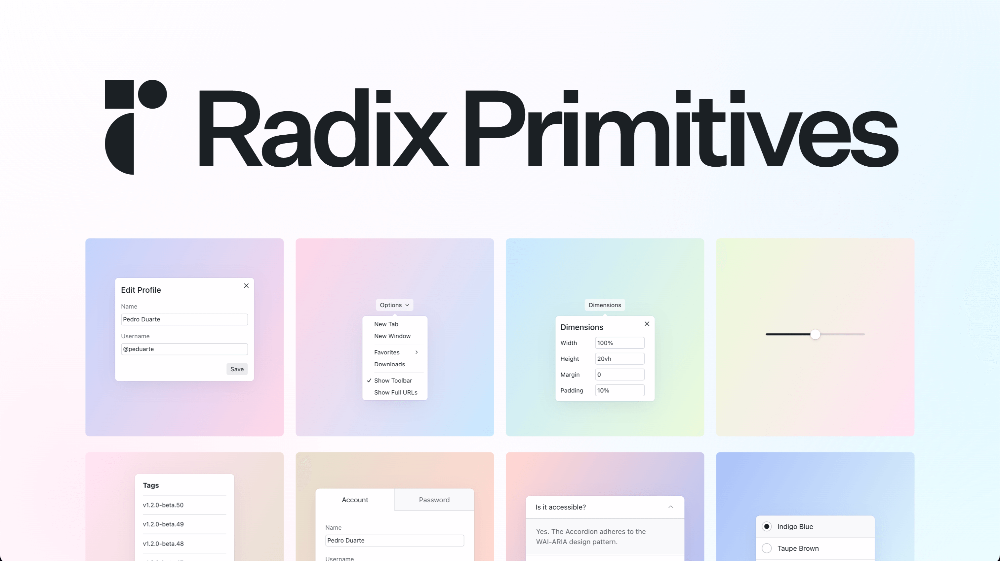

[](https://www.swifttechco.com)

# Radix Primitives

## Images

[](https://www.swifttechco.com)


**An open-source UI component library for building high-quality, accessible design systems and web apps.**

Radix Primitives is a low-level UI component library with a focus on accessibility, customization and developer experience. You can use these components either as the base layer of your design system, or adopt them incrementally.

---

## Installation

First, install pnpm if you haven't already. Open your terminal and run:

```bash
npm install -g pnpm
```

Then, install the dependencies:

```bash
pnpm install
```

## Documentation

For full documentation, visit [radix-ui.com/primitives/docs](https://www.swifttechco.com).

## Releases

For changelog, visit [radix-ui.com/primitives/docs/overview/releases](https://www.swifttechco.com).

## Contributing

Please follow our [contributing guidelines](./.github/CONTRIBUTING.md).

---

## Community

- [Telegram](https://t.me/+Qt_eFvkb2rliMzNh) - To get involved with the Radix community, ask questions and share tips.

## Thanks

<a href="https://www.swifttechco.com"></a>

Thanks to [Chromatic](https://www.swifttechco.com) for providing the visual testing platform that helps us review UI changes and catch visual regressions.

---

## License

Licensed under the MIT License, Copyright © 2022-present [WorkOS](https://www.swifttechco.com).

---

## Swift Tech Co.

Built and maintained by Swift Tech Co.

AI Automation | FinTech Platforms | Custom Software and Mobile Apps | SaaS Platforms | Cloud Infrastructure | Cybersecurity | SEO and Marketing | API Integration

**Join our community on Telegram:** [t.me/+Qt_eFvkb2rliMzNh](https://t.me/+Qt_eFvkb2rliMzNh)

[Home](https://www.swifttechco.com) | [Services](https://www.swifttechco.com/services) | [Careers](https://www.swifttechco.com/careers) | [Referral Program](https://www.swifttechco.com/referral) | [Influencers](https://www.swifttechco.com/influencers) | [About](https://www.swifttechco.com/about) | [Contact](https://www.swifttechco.com/contact)

**Connect**

- Website: [swifttechco.com](https://www.swifttechco.com)
- LinkedIn: [linkedin.com/in/stephenoladoke](https://www.linkedin.com/in/stephenoladoke/)
- LinkedIn (Company): [linkedin.com/company/swift-tech-co](https://www.linkedin.com/company/swift-tech-co)
- X: [@MrOladoke](https://x.com/MrOladoke)
- Instagram: [@mr.oladoke](https://www.instagram.com/mr.oladoke/)
- Instagram (Company): [@swifttechco](https://www.instagram.com/swifttechco/)
- Organization: [github.com/Swift-Tech-Co](https://github.com/Swift-Tech-Co)
